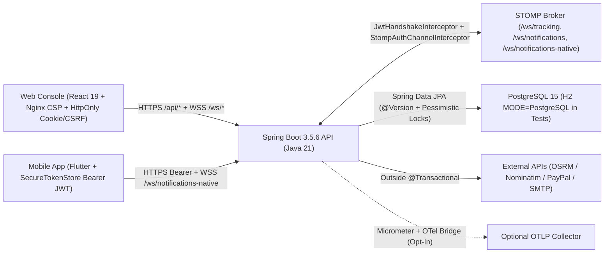
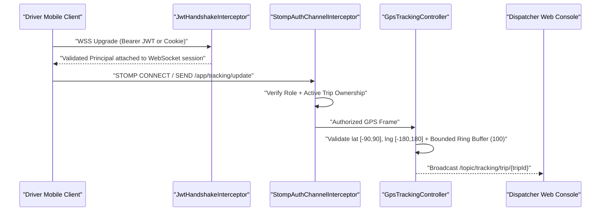

# LogiFlow System Architecture

This document describes the system architecture, architectural decisions, real-time STOMP security model, concurrency and transaction boundaries, observability pipeline, and failure recovery behavior of **LogiFlow**.

---

## 1. System Context & Component Architecture

LogiFlow is a multi-client logistics and dispatch platform composed of four layers:

- **Web Console (`client/`)**: React 19, Vite 7, React Router 7, Ant Design, Leaflet, Recharts, SockJS + `@stomp/stompjs`. Served behind Nginx (`client/nginx.conf`) with enforced Content-Security-Policy (CSP), reverse-proxied `/api/` and `/ws/` paths, and `HttpOnly` cookie + CSRF authentication hydrated via `/api/auth/me`.
- **Mobile App (`client_mobile/`)**: Flutter (Dart) application for Drivers (assigned trips, live GPS streaming, POD signature/photo capture) and Customers (order booking, live tracking, payment). Authenticates via `Authorization: Bearer` JWT persisted in `SecureTokenStore`.
- **Backend API (`server/`)**: Spring Boot 3.5.6 (Java 21), Spring Security (stateless JWT), Spring Data JPA, Spring WebSocket/STOMP (`SimpleBroker`), Micrometer Tracing + OpenTelemetry bridge.
- **Database & External Services**: PostgreSQL 15 in production/Docker Compose (H2 `MODE=PostgreSQL` in automated JUnit/MockMvc suites), plus external HTTP integrations for OSRM/Nominatim routing (`MapsServiceImpl`), PayPal Sandbox (`PayPalServiceImpl`), SMTP (`EmailServiceImpl`), and optional Cloudinary uploads.

### Real-Time STOMP & Dispatch Sequence

---

## 2. Key Architectural Decision Records (ADRs)

### ADR-01: Dual-Client Auth & Backend Routing Proxy with Enforced Nginx CSP
- **Context:** Browser sessions are vulnerable to XSS if JWTs live in `localStorage`, and calling third-party OSRM endpoints directly from the browser weakens Content-Security-Policy (`connect-src`).
- **Decision:** Web clients authenticate with `HttpOnly` cookies + CSRF protection and hydrate session identity via `/api/auth/me`, while Flutter mobile clients use `Authorization: Bearer` JWTs stored in `SecureTokenStore`. Routing requests flow through the backend proxy (`/api/maps/route` -> `MapsController` / `MapsServiceImpl`), allowing `client/nginx.conf` to enforce `default-src 'self'; script-src 'self'; connect-src 'self' ws: wss:; object-src 'none'; base-uri 'none'`.
- **Trade-offs & Known Limitations:** Proxying routing through the backend adds one extra network hop and places OSRM timeout/rate-limit handling on the Spring Boot tier, in exchange for tighter browser CSP and centralized timeout/observability control.

### ADR-02: Multi-Layer STOMP WebSocket Security
- **Context:** Authenticating only the initial HTTP WebSocket upgrade is insufficient if a connected customer or driver attempts to subscribe to another trip's live GPS topic or publish spoofed location frames.
- **Decision:** `WebSocketConfig` (`server/src/main/java/com/logiflow/server/websocket/WebSocketConfig.java`) pairs `JwtHandshakeInterceptor` (upgrade authentication) with `StompAuthChannelInterceptor` on the client inbound channel, enforcing RBAC and active trip/order ownership on STOMP `CONNECT`, `SUBSCRIBE`, and `SEND` frames alongside coordinate bounds checks in `GpsTrackingController` and `GpsLocationController`.
- **Trade-offs & Known Limitations:** Checking trip/order ownership during STOMP subscription adds a repository lookup on subscribe; `SimpleBroker` and the bounded in-memory GPS history cache (`MAX_HISTORY_PER_TRIP = 100`) are single-node in-memory structures. Multi-instance horizontal scaling would require replacing `SimpleBroker` with an external STOMP broker relay (e.g., RabbitMQ) and moving GPS history to Redis.

### ADR-03: Unified `TripStatus` FSM & Transaction Boundary Isolation
- **Context:** Direct status string mutations risked invalid lifecycle jumps (e.g., cancelling a completed trip), and executing external HTTP calls inside `@Transactional` blocks held JDBC connections open across slow network I/O.
- **Decision:** Trip transitions are routed through `TripStatus` and `TripServiceImpl.updateTripStatus`, combining JPA `@Version` optimistic locking with pessimistic locking on trip assignment and PayPal capture. External HTTP I/O (`MapsServiceImpl`, `PayPalServiceImpl`, `EmailServiceImpl`) runs outside `@Transactional` database locks, and failed payment records persist durably rather than rolling back into silent loss.
- **Trade-offs & Known Limitations:** Separating external HTTP calls from database transactions requires explicit idempotency checks on payment callbacks (`PaymentServiceImpl`) to safely handle retries.

### ADR-04: Schema Management (`ddl-auto=update` Locally, Validation Target for Production)
- **Context:** Rapid academic/iterative schema evolution favored Hibernate `ddl-auto=update` in Docker Compose and local development.
- **Decision:** Development and Compose currently use JPA `ddl-auto=update` without Flyway or Liquibase migrations configured yet.
- **Trade-offs & Known Limitations:** `ddl-auto=update` cannot safely express destructive schema refactors, data backfills, or repeatable zero-downtime production rollouts. Adopting Flyway/Liquibase with `JPA_DDL_AUTO=validate` is required before operating against persistent production data.

---

## 3. Data Integrity, Concurrency & Security Boundaries

| Boundary | Mechanism & Implementation |
| :--- | :--- |
| **HTTP RBAC & Filter Chain** | `SecurityConfiguration` (`server/src/main/java/com/logiflow/server/configs/SecurityConfiguration.java`) + `JwtAuthenticationFilter` enforce stateless JWT/cookie auth and role checks (`ADMIN`, `DISPATCHER`, `DRIVER`, `CUSTOMER`). Integration tests keep Spring Security filters enabled. |
| **STOMP & GPS Isolation** | `JwtHandshakeInterceptor` + `StompAuthChannelInterceptor` enforce `CONNECT`/`SUBSCRIBE`/`SEND` RBAC and trip/order ownership. `GpsTrackingController` validates coordinate ranges (`[-90, 90]`, `[-180, 180]`, rejects `NaN`/`Infinity`) and bounds in-memory history to 100 points per trip. |
| **Concurrency & Locking** | JPA `@Version` optimistic locking on mutable entities; pessimistic locking on driver trip assignment (`TripServiceImpl`) and PayPal capture (`PaymentServiceImpl`) to prevent double-booking and double-capture. |
| **Transaction Boundaries** | External HTTP calls (`MapsServiceImpl`, `PayPalServiceImpl`, SMTP `EmailServiceImpl`) execute outside `@Transactional` DB locks; payment failure state survives outer rollbacks. |
| **Browser Security Headers** | `client/nginx.conf` enforces `Content-Security-Policy`, `X-Content-Type-Options: nosniff`, `X-Frame-Options: SAMEORIGIN`, `Referrer-Policy`, `Permissions-Policy`, and `Cross-Origin-Opener-Policy`. |

---

## 4. Observability & Operational Readiness

- **Distributed Tracing:** Micrometer Tracing with the OpenTelemetry bridge (`opentelemetry-exporter-otlp` opt-in when configured).
- **Trace Correlation (`TraceCorrelationFilter`):** Ordered at `Ordered.HIGHEST_PRECEDENCE + 2` (immediately after Spring Boot's `ServerHttpObservationFilter` and before Spring Security's `FilterChainProxy`), ensuring every HTTP response — including `401`, `403`, `404`, and `500` — returns the active 32-character hex W3C `X-Trace-Id` header, exposed via CORS.
- **Log Correlation:** MDC propagates `traceId` and `spanId` into structured application logs.
- **Custom Operational Spans:** Instrumented across `TripServiceImpl`, `MapsServiceImpl`, `PayPalServiceImpl`, and `StompAuthChannelInterceptor` without tagging sensitive JWTs, cookies, or payment secrets.
- **Health Endpoint:** Spring Boot Actuator exposes `/actuator/health` (with `MAIL_HEALTH_ENABLED=false` default so optional SMTP does not degrade liveness).

---

## 5. Failure Scenarios & Recovery Matrix

| Failure Mode | System Behavior | Safeguard / Recovery | Known Limit |
| :--- | :--- | :--- | :--- |
| **Concurrent driver double-booking** | Competing assignment requests contend on trip/driver locks (`TripServiceImpl`). | Pessimistic locking + JPA `@Version` optimistic locking reject conflicting updates with a controlled conflict/business-rule response. | Backend integration tests verify lock paths on H2 `MODE=PostgreSQL`; PostgreSQL lock semantics are exercised in Compose/CI. |
| **PayPal duplicate capture / callback replay** | Repeat capture callbacks arrive for an already-paid order. | `PaymentServiceImpl` enforces pessimistic lock + idempotent `PAID` check, returning existing confirmation without duplicate capture or audit rows. Failed payment attempts persist durably outside rolled-back transactions. | Sandbox PayPal credentials only; production webhooks require live signature verification. |
| **OSRM / Nominatim routing timeout** | External routing or geocoding call stalls or returns 5xx. | Bounded HTTP client timeouts (`MapsServiceImpl`, verified by `MapsAndPayPalTimeoutUnitTest`) execute outside `@Transactional`, releasing DB connections immediately. | No local OSRM fallback cache; route polyline rendering degrades when external OSRM is unreachable. |
| **Unauthorized STOMP topic subscription** | Driver or customer attempts to `SUBSCRIBE` to another user's `/topic/tracking/trip/{id}` or `/topic/order/{id}`. | `StompAuthChannelInterceptor` rejects the frame before broker delivery and records an authorization span/event. | Single-node `SimpleBroker` does not replicate subscriptions across multiple backend instances. |
| **Malformed or high-frequency GPS frames** | Device sends `NaN`, `Infinity`, or out-of-range coordinates. | `GpsTrackingController` drops invalid frames without tearing down the WebSocket session; bounded circular buffer (`100` points/trip) prevents heap exhaustion. | In-memory GPS history is lost on backend restart. |

---

## 6. Verified Engineering & Testing Evidence

### Automated Test Suites (Verified in Repository & CI)

| Suite | Command | Verified Coverage & Scope |
| :--- | :--- | :--- |
| **Backend (JUnit 5 / MockMvc)** | `cd server && ./mvnw -B test` | **106 test methods across 28 test classes** covering `TripStatus` FSM, trip concurrency (`TripServiceConcurrencyIntegrationTest`), payment security & idempotency (`PaymentSecurityAndConcurrencyIntegrationTest`, `PaymentServiceIdempotencyTest`), STOMP/GPS authorization (`StompAndGpsAuthorizationIntegrationTest`, `WebSocketAuthAndRoutingIntegrationTest`), RBAC (`SecurityRbacIntegrationTest`), external timeouts (`MapsAndPayPalTimeoutUnitTest`), and OpenTelemetry tracing (`OpenTelemetryTracingIntegrationTest`). Runs against **H2 `MODE=PostgreSQL`**. |
| **Web Client (ESLint + Vite Build)** | `npm --prefix client run lint && npm --prefix client run build` | Verified static lint and production bundle build. |
| **Full-Stack E2E (Playwright)** | `npm --prefix client run test:e2e` | `client/e2e/logiflow-fullstack.spec.js` executed against Docker Compose (Spring Boot + PostgreSQL 15 + React/Nginx) in `.github/workflows/ci.yml`. |
| **Mobile (Flutter)** | `cd client_mobile && flutter analyze && flutter test` | Executed in GitHub Actions CI (`ci.yml`); Flutter CLI is not installed on the local Windows verification host (mobile changes verified in CI). |

### Performance & Scale Benchmarks
- **Sustained WebSocket fan-out, GPS ingestion rate, and p99 dispatch latency:** **Not measured under production load.**
- **Recommended Benchmark Method:** Run a staged load test (e.g., `k6` with WebSocket + REST scenarios) against Docker Compose with PostgreSQL 15 and OTLP tracing enabled to measure `SimpleBroker` fan-out ceiling and JDBC pool saturation under concurrent trip assignments.
